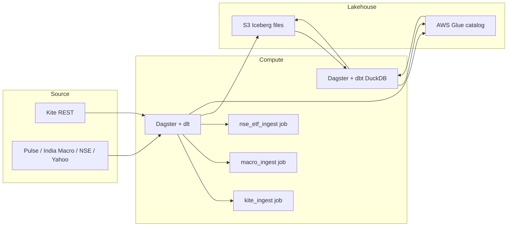
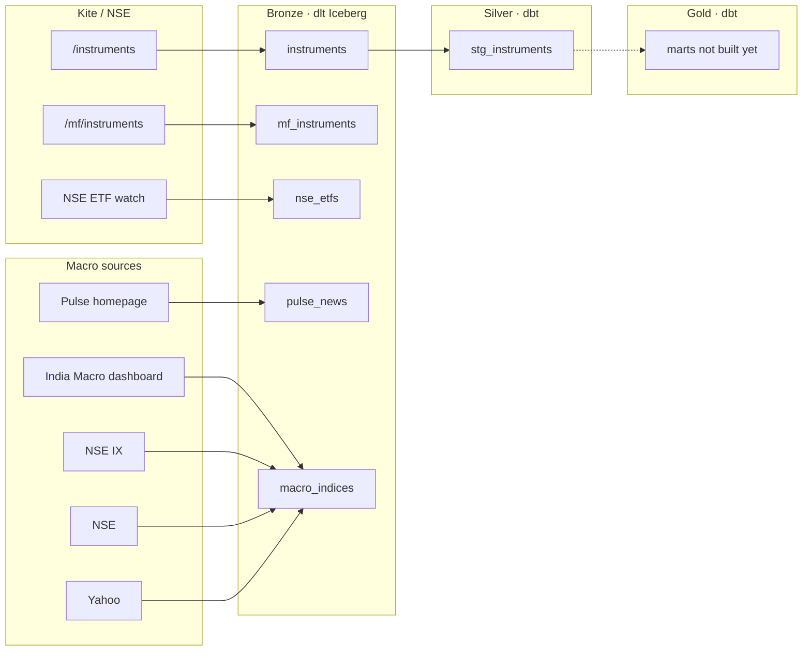
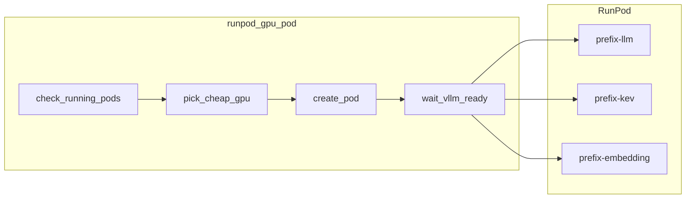
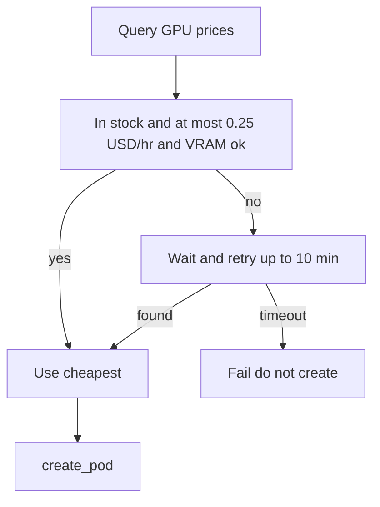
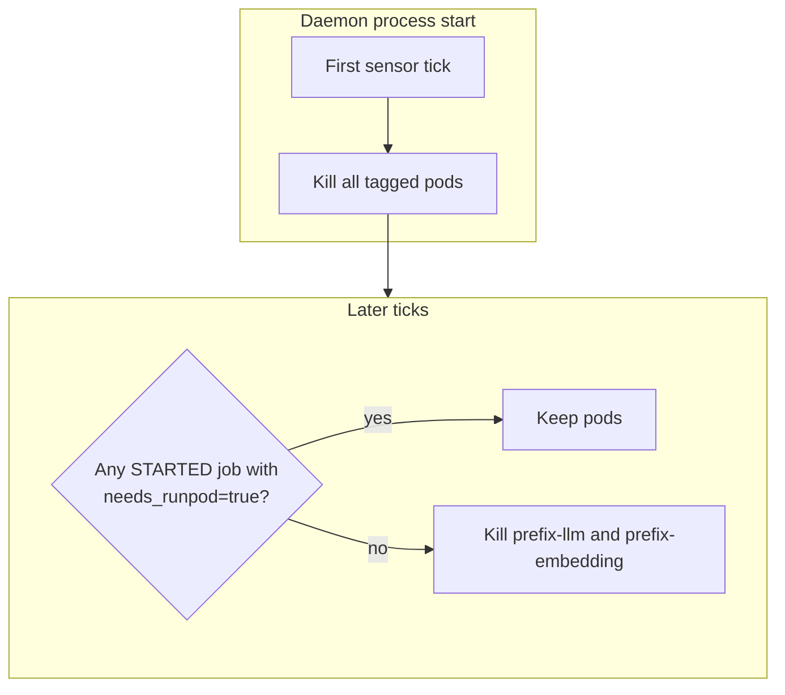

# investment_data_products

Dagster orchestration for an **Iceberg lakehouse** in **medallion** layers (bronze → silver → gold). **dlt** in this repo handles **ingestion (bronze)**. **dbt** in [investment-dbt](https://github.com/kunal-dey/investment-dbt) handles **silver and gold**. Data is stored as **Apache Iceberg** on **S3**; **AWS Glue** is the catalog. dbt compute is **DuckDB**. The same Dagster instance also manages optional **RunPod GPU pods** (vLLM / Kev / TEI), separate from the lakehouse.

Python: **3.12** (project allows `>=3.10,<3.15`; production is pinned to 3.12).

## Repositories

| Repo | Role |
| --- | --- |
| [kunal-dey/investment-data-products](https://github.com/kunal-dey/investment-data-products) | Dagster, dlt bronze ingestion, Iceberg plugin, EC2 deploy |
| [kunal-dey/investment-dbt](https://github.com/kunal-dey/investment-dbt) | dbt silver and gold (`dbt_project.yml`, models, `profiles.yml`) |

Dagster expects the dbt project at `{{ context.project_root }}/dbt`. On EC2 that path is a clone of `investment-dbt`. Locally, `dbt/` is gitignored here and is its own git repo (or a sibling folder + junction).

Do not commit `.env`.

## Lakehouse / medallion

This is a **lakehouse**: table format is Iceberg, files on S3, Glue as catalog, compute (dlt / DuckDB / dbt) is separate from storage.

| Layer | Owner | What it does today |
| --- | --- | --- |
| **Bronze** | **dlt** (this repo) | Kite dumps (`instruments`, `mf_instruments`), NSE ETFs (`nse_etfs`), and macro ingest (`pulse_news`, `macro_indices`) into Iceberg |
| **Silver** | **dbt** (`investment-dbt`) | Cleaned / staged models (`stg_instruments`) written back to Iceberg |
| **Gold** | **dbt** (`investment-dbt`) | Serving / mart models. None yet; they belong in the dbt repo, not here. |

Dagster only orchestrates both sides. It does not replace dbt for silver/gold.

## Architecture

How the lakehouse is wired. Glue is catalog only; files live on S3.



## Data flow

Kite is the only extract that dbt silvers. Pulse and dashboard/drivers stay bronze Iceberg (`macro_ingest`). GPU pods are under [GPU pods](#gpu-pods-runpod).



## Pipeline details

### Extract (dlt)

YAML component: `src/investment_data_products/defs/extraction_dlt_asset/defs.yaml` (`group_name: extract`).
Python: `src/investment_data_products/defs/extraction_dlt_asset/loads.py`.

In Dagster: **Assets → group `extract`**. Job **`kite_ingest`** materializes `instruments` and `mf_instruments`. Job **`nse_etf_ingest`** materializes `nse_etfs`. Job **`macro_ingest`** materializes `pulse_news` and `macro_indices`. Pulse selectors and indicator names: `defs/extraction_dlt_asset/macro_fetch.py`.

| Asset | Holds | Origin | Iceberg PK | Write |
| --- | --- | --- | --- | --- |
| `instruments` | One row per Kite tradable (equity + F&O) | Kite `/instruments` | `instrument_token` | replace |
| `mf_instruments` | One row per Kite mutual-fund scheme | Kite `/mf/instruments` | `tradingsymbol` | replace |
| `nse_etfs` | One row per listed NSE ETF (quotes + NAV) | NSE `/api/etf` | `symbol` | replace |
| `pulse_news` | One row per Pulse news card this scrape | Zerodha Pulse HTML | `pulse_id` | replace |
| `macro_indices` | Latest reading per named indicator or driver | India Macro Indicators + GIFT/FPI | `name` | merge |

Kite returns `text/csv`. dlt `rest_api_source` expects JSON, so `csv_response_to_json` converts the body. Loads use `table_format: iceberg` into the filesystem destination with explicit AWS credentials. dlt also adds `_dlt_id` and `_dlt_load_id`.

`/instruments` is a large dump (equities + F&O). First materialization can take a long time: the full CSV is loaded into Python, converted to JSON, then written as Iceberg to S3. Pulse ingest fails closed if fewer than 50 cards or a layer-1/layer-2 name is missing (weekends are thinner than 200). ETF ingest fails closed if fewer than 50 rows. NSE JSON needs a homepage cookie first (`macro_fetch._nse_json`).

#### Extract table schemas

Glue database = `GLUE_DATABASE`. Location = `${S3_LAKE_BASE}/${GLUE_DATABASE}/<asset>`.

**`instruments` / `mf_instruments`:** Full Kite instrument dumps (what you can trade). Schema is the CSV header (not declared in this repo). PK as in the table above.

**`nse_etfs`** — one row per NSE-listed ETF from the [ETF market watch](https://www.nseindia.com/market-data/exchange-traded-funds-etf) (`/api/etf`). Replace each run.

| Column | Type | Meaning |
| --- | --- | --- |
| `symbol` | string | NSE ticker (PK) |
| `underlying` | string | Underlying asset description |
| `series` | string | e.g. `EQ` |
| `open` / `high` / `low` / `prev_close` / `ltp` | float | Session quotes |
| `change` / `pct_change` | float | vs previous close |
| `volume` | int64 | Shares traded |
| `traded_value` | float | Notional (₹) |
| `nav` | float | Latest NAV |
| `week_high` / `week_low` | float | 52-week range |
| `pct_change_30d` / `pct_change_365d` | float | Trailing % |
| `as_of` | timestamptz | NSE snapshot time (IST parsed to UTC) |
| `source` | string | `nse` |

**`pulse_news`** — one row per Pulse card (headline, time, related items) from this ingest.

| Column | Type | Meaning |
| --- | --- | --- |
| `pulse_id` | string | Pulse card `data-id` |
| `headline` | string | Card title |
| `summary` | string | Card blurb |
| `published_at` | timestamptz | Parsed UTC from `span.date[title]` |
| `related_headlines` | string | Similar items, ` \| ` joined |
| `related_count` | int64 | Count of similar items |

**`macro_indices`** — one row per dashboard series: layer-1 regime indexes, layer-2 indicators, and short-horizon drivers (GIFT, FPI, …). Merge keeps the latest by `name`.

| Column | Type | Meaning |
| --- | --- | --- |
| `name` | string | Indicator or driver name (PK) |
| `group` | string | `REGIME`, layer-2 group, or `SHORT_HORIZON` |
| `value` | float | Latest reading |
| `unit` | string | e.g. index, %, points |
| `as_of` | timestamptz | Observation time |
| `source` | string | `indiamacroindicators`, `nseix`, … |

### Transform (dbt)

YAML: `src/investment_data_products/defs/dbt_asset/defs.yaml`
Runs `dbt build`. Dagster needs `dbt/target/manifest.json` (`dbt parse`) or definitions fail to load.

Source `data_platform_catalog.instruments` is an external DuckDB `iceberg_scan` of:

`${S3_LAKE_BASE}/${GLUE_DATABASE}/instruments`

Model `stg_instruments` is a cleaned slice of `instruments` (one row per instrument, selected fields). Models are tables. A project-wide **post_hook** calls DuckDB UDF `write_iceberg_relation`, implemented in `src/investment_data_products/dbt_plugins/iceberg_store.py` (PyIceberg + Glue overwrite/create).

DuckDB Iceberg reads need `unsafe_enable_version_guessing: true` because dlt often writes `v{n}.metadata.json` without `version-hint.text`. `numpy` is required for the UDF.

## Dagster layout

YAML components under `src/investment_data_products/defs/`, loaded by `definitions.py` via `load_from_defs_folder`. Required env vars:

- `S3_LAKE_BASE` — e.g. `s3://data-platform-427899482524-ap-south-1-an`
- `GLUE_DATABASE` — e.g. `data_platform_catalog`
- `AWS_ACCESS_KEY_ID`
- `AWS_SECRET_ACCESS_KEY`
- `AWS_REGION`

GPU jobs also require `RUNPOD_API_KEY`, `VLLM_API_KEY`, `VLLM_PORT` (see [GPU pods](#gpu-pods-runpod)).

## Asset graph

- Group **`extract`**: `instruments`, `mf_instruments`, `nse_etfs`, `pulse_news`, `macro_indices`
- Group **`dbt`**: `stg_instruments` (depends on `instruments`)
- Job **`kite_ingest`**: `instruments` + `mf_instruments` (no GPU tag)
- Job **`nse_etf_ingest`**: `nse_etfs` (no GPU tag)
- Job **`macro_ingest`**: `pulse_news` + `macro_indices` (no GPU tag)
- Job **`runpod_gpu_pod`**: optional GPU create/wait (`needs_runpod=true`) — see [GPU pods](#gpu-pods-runpod)

## GPU pods (RunPod)

Optional GPU lifecycle on **[RunPod Pods](https://docs.runpod.io/pods/overview)** (not Serverless). This is **not** bronze/silver/gold. Job `runpod_gpu_pod` is **check → pick cheapest GPU → create → health wait**. An unready pod is **deleted** on health timeout. `kite_ingest`, `nse_etf_ingest`, and `macro_ingest` do not start GPUs.

Create does **not** default to RTX 4090. It picks the cheapest **compatible in-stock** GPU at **≤ $0.25/hr** (llm and kev ≥16 GB SM 7.5+, embedding ≥8 GB TEI-capable), or waits **up to 10 minutes**, then fails without creating. Do not pin `RUNPOD_GPU_TYPE` unless you are debugging one SKU.

Use **ops** (Airflow-like tasks) plus **one sensor**. Kill cannot be the last op of the create job: that job *is* a running task.

### Pod job

Launch job `runpod_gpu_pod` (Python: `src/investment_data_products/defs/runpod.py`). Set op config `ops.check_running_pods.config.model_kind` to `llm`, `kev`, or `embedding`. Tag: `needs_runpod=true`. At most **one pod per kind**; kinds can be up at once.



| Op | Behavior |
| --- | --- |
| `check_running_pods` | List pods for **this** `model_kind` only. If that kind is `RUNNING`/`STARTING`, fail. Embedding or kev up does **not** block LLM. **List API error → fail** (never treat as “no pod”). |
| `pick_cheap_gpu` | Query Runpod GPU prices. Keep types that are **in stock**, **≤ $0.25/hr**, and meet a VRAM floor (`llm`/`kev` ~16 GB, `embedding` ~8 GB). **llm** and **kev** skip V100/Volta. **embedding** skips Volta/Pascal (TEI has no image). Use the **cheapest**. If none, **wait up to 10 minutes** then **fail**. Never create a GPU over the cap. Prefer **COMMUNITY** when that is the cheap quote. |
| `create_pod` | `POST` one pod named `{prefix}-{model_kind}`. **Loops each cheap GPU one at a time** (cheapest first). If that type is unavailable (Runpod 500), try the next. After all have failed, wait up to 10 minutes and try again. Dagster does **not** retry the op. Returning `pod_id` is **not** ready. Ports are `{VLLM_PORT}/tcp` and `{VLLM_PORT}/http`. **llm** env: `VLLM_WORKER_MULTIPROC_METHOD=spawn`, `VLLM_USE_V1=0` (do **not** set `CUDA_VISIBLE_DEVICES` — vLLM wants the RunPod UUID). **kev** is PyTorch + `python -m kev.serve` (not vLLM chat). **embedding** is TEI only: wait for `nvidia-smi`, then `CUDA_VISIBLE_DEVICES=0` so Candle does not CPU-fallback. |
| `wait_vllm_ready` | Poll mapped `publicIp:port` when Runpod assigns one; otherwise the HTTP proxy. Ready on 200 (`/v1/models` for llm, `/v1/systemone` for kev, `/health` for TEI). Image pull + weights can take **15–20 minutes**. On timeout, **DELETE** the pod so a crash loop does not keep billing. |



### Models

Three frozen stacks. Do not copy env or start flags from one kind to the other.

| Kind | Image | Model | Notes |
| --- | --- | --- | --- |
| `kev` | `runpod/pytorch:2.4.0-py3.11-cuda12.4.1-devel-ubuntu22.04` (override `RUNPOD_KEV_IMAGE`) | `jaredpalmer/kev-8b` (override `KEV_MODEL`) | **Not vLLM chat.** Clone + `uv python install 3.12` + `uv sync --extra serve` (do **not** `pip install kev` — PyPI is a different package, and git+pip on 3.11 cannot install `numpy>=2.5.3`). `kev.serve --host 0.0.0.0 --device cuda` (`POST /v1/systemone`). Binds `127.0.0.1` unless `--host 0.0.0.0`. Set `KEV_API_KEY` (= `VLLM_API_KEY`) and `HF_TOKEN`. First boot can take **30–45 min**. |
| `llm` | `vllm/vllm-openai:v0.10.2` (override `RUNPOD_IMAGE_NAME`) | `Qwen/Qwen3-8B-AWQ` | vLLM **V0** (`VLLM_USE_V1=0`) to avoid EngineCore CUDA crashes on Community Pods. AWQ needs **SM 7.5+**; picker skips V100. `--max-model-len 16384`, tool calling (`hermes`), `--reasoning-parser qwen3`. Recreate the llm pod after changing start flags. Untagged `latest` is CUDA 13 and fails on cheap hosts. |
| `embedding` | TEI 1.9 by GPU (`86-1.9` Ampere 8.6, `1.9` A100/A30, `turing-1.9` T4/2080, `89-1.9` Ada, `hopper-1.9` H100). Override `RUNPOD_EMBED_IMAGE`. | `Qwen/Qwen3-Embedding-0.6B` | **Not vLLM.** Wait for `nvidia-smi`, then `CUDA_VISIBLE_DEVICES=0` (Candle treats a RunPod GPU UUID as `CUDA_ERROR_UNKNOWN` and falls back to CPU; 16k-token CPU warmup then restart-loops). `--dtype float16 --max-batch-tokens 2048 --max-client-batch-size 32`. |

### Cleanup sensor

**One** sensor `runpod_idle_cleanup` (not one per model). It never cancels dlt/dbt runs.



| What is running | Sensor |
| --- | --- |
| dlt / dbt / `kite_ingest` / `nse_etf_ingest` / `macro_ingest` only | Kill pods (lakehouse does not need GPU) |
| `runpod_gpu_pod` `STARTED` (llm and/or embedding, including health wait) | Do not kill |
| Later inference job tagged `needs_runpod=true` `STARTED` | Do not kill |
| Only untagged jobs | Kill pods |

**Daemon restart:** first tick always reaps leftover GPUs from a crash, even if stale runs look `STARTED`. If `dagster-daemon` **is down**, pods keep billing — the sensor does not run on the webserver alone.

**After create/wait finishes:** pods are killed unless another **tagged** job is still `STARTED`. Health wait does not keep the GPU forever. Future inference must use `needs_runpod=true` and stay `STARTED` while you need the models.

### Environment (verified names)

Local `.env` (gitignored) must include these **names**. Do not put real values in git or the README.

| Variable                  | Required | This project                                                       |
| ------------------------- | -------- | ------------------------------------------------------------------ |
| `RUNPOD_API_KEY`          | yes      | RunPod REST list / create / stop (`rpa_…` from the RunPod console) |
| `VLLM_API_KEY`            | yes      | Injected as vLLM `--api-key` and health `Authorization: Bearer …`  |
| `VLLM_PORT`               | yes      | `8000` — listen, publish, llm `/v1/models`, kev `/v1/systemone`, TEI `/health` |
| `RUNPOD_MAX_USD_PER_HOUR` | no       | Price cap for picker. Default `0.25`.                              |
| `RUNPOD_GPU_WAIT_SECONDS` | no       | How long to wait for a cheap GPU. Default `600` (10 minutes).      |
| `RUNPOD_GPU_TYPE`         | no       | Emergency **pin** only (skip picker). **No 4090 default.**         |

Other optional: `RUNPOD_IMAGE_NAME` (llm only, `vllm/vllm-openai:v0.10.2`), `RUNPOD_KEV_IMAGE` (kev only), `KEV_MODEL` (default `jaredpalmer/kev-8b`), `HF_TOKEN` / `HUGGING_FACE_HUB_TOKEN` (kev Qwen3-8B-Base download), `RUNPOD_EMBED_IMAGE` (embedding only, default TEI tag for the picked GPU), `RUNPOD_CLOUD_TYPE` (follow the cheap quote, often `COMMUNITY`), `RUNPOD_CONTAINER_DISK_GB` (`80`), `RUNPOD_NAME_PREFIX` (`investment-data-products`).

`dg dev` and systemd both need the same three GPU vars in process env (`EnvironmentFile` on EC2). Copy them to `/etc/investment_data_products.env` on the VM; do not rely on git.

### Cost

Each pod is **≤ $0.25/hr**. Do not fall back to 4090 if nothing cheap is in stock — wait up to 10 minutes, then fail. Other guards: fail-closed create, idle sensor, daemon startup reap. Optional extra: a spend cap in the RunPod account UI.

### How to verify

1. Launch `runpod_gpu_pod` with `llm`, `kev`, and `embedding` — kinds can be up at once.
2. Logs show a GPU type **≤ $0.25/hr**, not 4090. If nothing cheap is in stock, the job waits up to 10 minutes then fails without creating.
3. Job stays `STARTED` until health succeeds (`/v1/models`, `/v1/systemone`, or `/health`), not merely until `pod_id`.
4. LLM logs must pass EngineCore without a `CUDA unknown error` restart loop (V0 + no `CUDA_VISIBLE_DEVICES`). Kev is PyTorch System One, not that vLLM stack. TEI `/health` is unchanged.
5. A second launch of the **same** kind must fail.
6. After jobs end and no tagged inference is running, **one** sensor removes leftover pods.
7. Restart `dagster-daemon` — tagged pods should be reaped on the first tick.

## Local development

Ensure [`uv`](https://docs.astral.sh/uv/) is installed. Python is pinned in `.python-version`.

```bash
uv sync --group dev --python 3.12
```

| OS | Activate venv |
| --- | --- |
| macOS / Linux | `source .venv/bin/activate` |
| Windows | `.venv\Scripts\activate` |

Clone or keep [investment-dbt](https://github.com/kunal-dey/investment-dbt) at `./dbt`. Put secrets in `.env` (gitignored):

```bash
AWS_ACCESS_KEY_ID=...
AWS_SECRET_ACCESS_KEY=...
AWS_REGION=ap-south-1
S3_LAKE_BASE=s3://your-lake-bucket
GLUE_DATABASE=data_platform_catalog
PYICEBERG_CATALOG__DEFAULT__TYPE=glue
DAGSTER_HOME=D:/wealth_data_products/investment_data_products/.dagster_home
RUNPOD_API_KEY=...
VLLM_API_KEY=...
VLLM_PORT=8000
HF_TOKEN=...
```

`DAGSTER_HOME` must be a real directory (not the user profile). Without it, `dg dev` uses `.tmp_dagster_home_*` and `DbtProjectComponent` fails on Windows with `sqlite3.OperationalError: unable to open database file`.

Optional GPU: `RUNPOD_MAX_USD_PER_HOUR=0.25`, `RUNPOD_GPU_WAIT_SECONDS=600`, `RUNPOD_GPU_TYPE` (pin only; no 4090 default), `RUNPOD_IMAGE_NAME`, `RUNPOD_KEV_IMAGE`, `KEV_MODEL`, `HF_TOKEN`, `RUNPOD_CLOUD_TYPE`, `RUNPOD_CONTAINER_DISK_GB`, `RUNPOD_NAME_PREFIX`.

Then:

```bash
uv run dbt parse --project-dir dbt --profiles-dir dbt
dg dev
```

Open http://localhost:3000

Pip alternative:

```bash
python3 -m venv .venv
# activate, then:
pip install -e ".[dev]"
```

## Production (EC2)

Typical layout:

- App: `/opt/investment_data_products` (user `dagster`)
- dbt clone: `/opt/investment_data_products/dbt`
- Secrets: `/etc/investment_data_products.env` (mode `600`, owner `dagster`)
- Instance metadata: `DAGSTER_HOME=/home/dagster/dagster_home`

systemd units in `deploy/`:

- `dagster-webserver` — `0.0.0.0:3000`
- `dagster-daemon`

Both units set `DAGSTER_HOME`, `PYTHONPATH`, and `PATH` including `.venv/bin` so the `dbt` executable is found.

The env file should include AWS keys, `S3_LAKE_BASE`, `GLUE_DATABASE`, `DAGSTER_HOME`, `PATH=/opt/investment_data_products/.venv/bin:...`, and for GPU pods `RUNPOD_API_KEY`, `VLLM_API_KEY`, `VLLM_PORT`. The **daemon** must see those RunPod vars or it cannot list/stop pods.

Use **Python 3.12 via uv** on the host, not Ubuntu’s 3.14 (PyIceberg/`mmh3` wheels).

## CI/CD

**This repo** (`.github/workflows/deploy.yml`):

1. Check: checkout this repo + `kunal-dey/investment-dbt` into `dbt/`, `uv sync`, `dg check yaml`
2. Deploy: SSH to EC2, reset Dagster `main`, pull/clone dbt, `uv sync --group dev --python 3.12`, `dbt parse`, install systemd units, restart services

Secrets (environment `production`): `EC2_HOST`, `EC2_USER`, `EC2_SSH_KEY`

**investment-dbt**: on push to `main`, SSH to the same host, update `/opt/.../dbt`, `dbt parse`, restart Dagster. Same three secrets on that repo’s `production` environment.

## Learn more

- [Dagster Documentation](https://docs.dagster.io/)
- [dlt](https://dlthub.com/docs)
- [dbt-duckdb](https://github.com/duckdb/dbt-duckdb)
- [Apache Iceberg](https://iceberg.apache.org/)
- [RunPod Pods](https://docs.runpod.io/pods/overview)
- [vLLM OpenAI server](https://docs.vllm.ai/en/latest/serving/openai_compatible_server.html)
